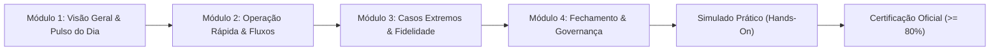

# SMG Academy — Central de Capacitação & Certificação

> **SMG Barber — The Barbershop Intelligence** 
> **Entidade Mantenedora:** SMG Intelligence (Masterbrand Tech) 
> **Data de Atualização:** 2026-11-04 
> **Status:** CANÔNICO E OBRIGATÓRIO 
> **Responsável Formal:** Augusto (PO) 
> **Público-Alvo:** Donos, Gerentes, Recepcionistas, Operadores de Caixa e Barbeiros

---

## 1. Manifesto Pedagógico da SMG Academy

Gerenciar uma barbearia moderna deixou de ser uma tarefa manual. O mercado exige agilidade de balcão, inteligência de dados, prevenção ativa de churn e controle financeiro com tolerância zero para divergências.

A **SMG Academy** é o ecossistema oficial de treinamento e certificação técnica do **SMG Barber**, desenvolvido para transformar qualquer equipe operacional em especialistas de alta performance em menos de **2 horas**.

### O Método em 3 Etapas:
1. **Aprenda o Método (Conteúdo Guiado):** Entenda a lógica por trás de cada fluxo do sistema (Cockpit, Agenda, Comandas, Checkout, Caixa e Club).
2. **Pratique sem Risco (Simulação no Local Demo Mode):** Execute os cenários reais do dia a dia utilizando o ambiente de demonstração (`teste@soumanager.local` / `12345678`) sem afetar dados reais da sua barbearia.
3. **Conquiste a Certificação Oficial (Selo de Especialista):** Realize a avaliação prática e a prova conceitual. Ao atingir **80% ou mais** de aproveitamento, obtenha seu **Certificado de Especialista Operacional SMG Barber** emitido pela *SMG Intelligence*.

---

## 2. Catálogo das Trilhas Curriculares por Papel (Role)

| Trilha Curricular | Carga Horária | Público Principal | Certificação Concedida |
|---|:---:|---|---|
| [**1. Especialista em Recepção & Caixa Ágil**](./TRILHA_RECEPCAO_E_CAIXA.md) | 45 min | Recepcionistas, Hostess e Operadores de Caixa | *Certificado de Especialista em Balcão e Caixa Ágil* |
| [**2. Barbeiro Digital & Bancada Lucrativa**](./TRILHA_BARBEIRO_BANCADA.md) | 30 min | Barbeiros, Cabeleireiros e Terapeutas Capilares | *Certificado de Barbeiro Digital & Bancada Lucrativa* |
| [**3. Gestão Executiva & Dono da Barbearia**](./TRILHA_GESTAO_E_DONO.md) | 60 min | Donos, Sócios, Gerentes Gerais e Consultores | *Certificado de Gestão Executiva & Business Intelligence* |

---

## 3. Estrutura dos Cursos e Metodologia

Cada trilha é estruturada em 4 módulos progressivos com foco prático:

### 3.1 Pilares Práticos Ensinados
- **Agilidade e Zero Filas:** Abertura relâmpago de comandas com tecla `N`, buscas debounced e checkout em 2 cliques.
- **Transparência Financeira (ADR-001):** Fechamento de caixa com conferência física cega, repasse automático de taxas de cartão e extratos transparentes de bancada.
- **Cadeira Cativa & Fidelidade Recorrente:** Projeção de 12 sessões semanais e planos do Club dos Chefes.
- **Inteligência Preditiva contra Churn:** Campanhas de recuperação de clientes inativos (> 30 dias) via WhatsApp com 1 clique.

---

## 4. Sistema de Certificação e Reciclagem

O processo de certificação é regulamentado em [`docs/academy/SISTEMA_DE_CERTIFICACAO.md`](./SISTEMA_DE_CERTIFICACAO.md):

- **Nota de Corte:** 80% de acertos na avaliação combinada (Prova Teórica + Avaliação de Simulação Prática).
- **Validade do Selo:** 12 meses. A cada grande atualização da plataforma (ex: lançamento de novos módulos de inteligência), os profissionais realizam uma reciclagem expressa de 15 minutos para renovação da credencial.
- **Selo para Marketing:** As barbearias com 100% da equipe certificada recebem o selo dourado digital **"Unidade Certificada SMG Barber"** para divulgação em redes sociais, website e fachada.

---

## 5. Acesso Rápido às Trilhas

- 👉 [Acessar Trilha 1: Recepção & Caixa Ágil](./TRILHA_RECEPCAO_E_CAIXA.md)
- 👉 [Acessar Trilha 2: Barbeiro Digital & Bancada Lucrativa](./TRILHA_BARBEIRO_BANCADA.md)
- 👉 [Acessar Trilha 3: Gestão Executiva & Dono da Barbearia](./TRILHA_GESTAO_E_DONO.md)
- 👉 [Consultar Regras do Sistema de Certificação](./SISTEMA_DE_CERTIFICACAO.md)
