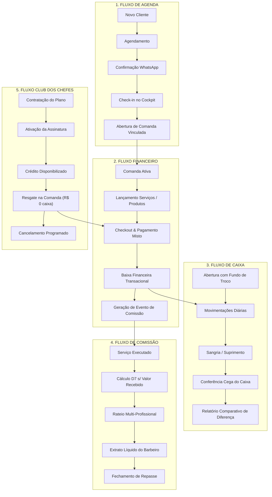

# Dossiê de Certificação dos Fluxos de Negócio — SMG Barber

> **SMG Barber** · *The Barbershop Intelligence* 
> **Masterbrand Tech:** SMG Intelligence 
> **Classificação:** Certificação Oficial de Integridade Funcional e Transacional (Fase 7.9) 
> **Última Atualização:** 2026-11-04 · Versão 1.0

---

## 1. Visão Geral & Manifesto de Integridade Ponta a Ponta

A **Certificação dos Fluxos de Negócio (Business Flow Certification)** atesta formalmente que o **SMG Barber** opera com continuidade estrita, fidelidade contábil e zero quebra transacional nos 5 processos centrais que sustentam uma barbearia de alta performance.

Cada fluxo foi homologado sob o princípio da **Tolerância Zero**:
$$\sum \text{Entradas} - \sum \text{Saídas} - \sum \text{Comissões} - \sum \text{Retenção da Casa} = \Delta \text{ R\$} 0,00$$

A separação canônica preconizada no **ADR-001** é rigorosamente mantida:
- **Comissão Teórica Calculada (`domain/commission/`):** Mede o direito adquirido do profissional pela execução do serviço/venda com base no valor efetivamente recebido.
- **Liquidação Efetiva de Caixa (`application/cashClosing/`):** Rateia a disponibilidade financeira real do dia para pagamento dos profissionais e apuração do resultado operacional da unidade.

---

## 2. Mapa dos 5 Fluxos Vitais Homologados

---

## 3. Especificação Detalhada dos 5 Fluxos Vitais

### 3.1 Fluxo 1: Agenda & Atendimento Operacional
**Trilha:** `Novo Cliente → Agendamento → Confirmação → Check-in → Comanda`

1. **Novo Cliente:**
   - O cliente fornece nome e telefone. O sistema sanitiza para o padrão E.164 (`+55 11 9XXXX-XXXX`) e verifica se já existe cadastro ativo para evitar duplicidade.
2. **Agendamento:**
   - A recepção ou o cliente seleciona a cadeira/barbeiro, os serviços desejados e o horário.
   - O sistema calcula a duração combinada dinâmica dos serviços (com intervalo técnico de 5 min) e valida a inexistência de sobreposição na grade do profissional.
3. **Confirmação:**
   - Disparo do link de confirmação amigável via WhatsApp em 1 clique.
   - O agendamento assume o status `confirmed`.
4. **Check-in:**
   - O cliente se apresenta na barbearia. O operador aciona o botão de Check-in no Cockpit matinal.
   - O status transiciona para `in_progress`.
5. **Comanda Vinculada:**
   - O sistema gera automaticamente uma comanda vinculada com o `appointment_id`, preservando os itens agendados e atribuindo os respectivos profissionais para cada serviço.

---

### 3.2 Fluxo 2: Financeiro & Checkout de Balcão
**Trilha:** `Comanda → Produtos/Serviços → Checkout → Financeiro → Comissão`

1. **Lançamento de Itens Adicionais:**
   - O barbeiro ou recepção adiciona produtos de bancada (pomada, óleo de barba, bebidas) diretamente à comanda aberta.
2. **Checkout & Divisão de Pagamento:**
   - Na tela de liquidação, o operador seleciona um ou mais meios de pagamento (Ex: PIX, Cartão de Crédito, Cartão de Débito, Dinheiro ou Créditos do Clube).
   - O somatório das parcelas liquidadas deve igualar com exatidão o valor total da comanda:
     $$\sum \text{Parcelas} = \text{Total da Comanda}$$
3. **Baixa Financeira Transacional:**
   - A comanda é finalizada mudando o status para `paid` e preenchendo o timestamp `closed_at`.
   - Se houver produtos físicos, o estoque no inventário é decrementado atomicamente.
4. **Disparo do Pipeline de Comissão:**
   - O sistema emite o evento transacional de fechamento, disparando o motor de comissões para apuração do direito de cada profissional.

---

### 3.3 Fluxo 3: Caixa & Fechamento Noturno Cego
**Trilha:** `Abertura → Movimentações → Sangria/Suprimento → Fechamento Cego → Relatórios`

1. **Abertura com Fundo de Troco:**
   - O operador inicia o turno informando o valor de abertura (ex: R\$ 150,00 em cédulas trocadas). O caixa entra em estado `open`.
2. **Movimentações Diárias:**
   - Recebimentos em dinheiro físico provenientes de comandas liquidadas incrementam o saldo em espécie na gaveta. Pagamentos em PIX ou Cartão são computados nas suas respectivas contas contábeis virtuais.
3. **Suprimento e Sangria:**
   - **Suprimento:** Adição extraordinária de troco com justificativa registrada.
   - **Sangria:** Retirada segura de numerário durante o expediente com categoria de despesa obrigatória.
4. **Fechamento Cego:**
   - Ao término do expediente, o operador não visualiza o saldo teórico do sistema. Ele conta fisicamente as cédulas e moedas na gaveta e digita a contagem real apurada.
5. **Apuração de Divergência:**
   - O sistema compara o valor físico contado com o saldo calculado pelas movimentações:
     $$\text{Diferença de Caixa} = \text{Valor Contado} - (\text{Abertura} + \sum \text{Entradas Dinheiro} + \sum \text{Suprimentos} - \sum \text{Sangrias})$$
   - É gerado o relatório de auditoria identificando se houve exatidão, sobra ou quebra de caixa.

---

### 3.4 Fluxo 4: Comissão & Rateio Proporcional D7
**Trilha:** `Serviço Executado → Cálculo D7 → Rateio Proporcional → Extrato do Barbeiro → Exportação`

1. **Base Efetiva de Recebimento:**
   - Conforme o motor D7, a base de cálculo da comissão é o valor efetivamente pago pelo cliente (deduzidos descontos promocionais e proporcionalidades):
     $$\text{Base do Item} = \text{Valor Recebido do Item} \times \text{Participação do Barbeiro}$$
2. **Rateio Multi-Profissional:**
   - Se uma comanda envolveu dois profissionais em serviços distintos, cada profissional recebe exclusivamente sobre a sua alíquota acordada e o serviço por ele executado.
3. **Extrato Líquido do Barbeiro:**
   - O barbeiro visualiza em seu aplicativo mobile o extrato detalhado com o valor bruto gerado, as taxas de maquininha deduzidas (quando contratualmente aplicável), eventuais vales/adiantamentos e o valor líquido a receber.
4. **Exportação & Prestação de Contas:**
   - O gestor consolida o período e exporta o relatório analítico em PDF ou planilha para liquidação sem atrito entre as partes.

---

### 3.5 Fluxo 5: Club dos Chefes (Assinatura Recorrente)
**Trilha:** `Plano → Assinatura → Ciclo de Créditos → Resgate na Comanda → Cancelamento`

1. **Contratação & Ativação:**
   - O cliente assina um plano mensal (Ex: *Plano Ouro* - R\$ 160,00/mês com 4 créditos de corte simples). O status da assinatura passa a `active`.
2. **Disponibilização de Créditos:**
   - A cada ciclo mensal renovado, o sistema concede 4 créditos vinculados ao ID do cliente e ao catálogo de serviços elegíveis.
3. **Resgate na Comanda (Custo R\$ 0,00 no Caixa Diário):**
   - O assinante vai à barbearia e faz o corte. Na comanda, a recepção clica em **Resgatar Crédito do Clube**.
   - O sistema abate 1 crédito da conta do assinante (saldo passa de 4 para 3).
   - A comanda fecha com `total = R$ 0,00` e método `Club dos Chefes`.
   - **Invariante ADR-001:** Nenhuma cédula ou transação de cartão entra na contagem do caixa diário físico, prevenindo qualquer inflação indevida de receita do dia.
   - A comissão do barbeiro é gerada com base no valor de tabela acordado do serviço no plano do Clube.
4. **Cancelamento Programado:**
   - Caso o cliente solicite o cancelamento, a assinatura é marcada para encerrar ao fim do ciclo atual (`cancel_at_period_end = true`). Os créditos remanescentes do período pago continuam válidos até o encerramento dos 30 dias.

---

## 4. Matriz de Evidências dos Testes Automatizados

A suíte automatizada `tests/flows/fase7_9_business_flow.test.ts` implementa testes ponta a ponta exercitando os 5 fluxos sem atalhos:

| Fluxo Testado | Identificador | Condição Verificada | Veredito |
|---|---|---|---|
| **Fluxo 1: Agenda** | `FLOW-SCH-001` | Ciclo completo: Criação de Cliente $\rightarrow$ Agendamento $\rightarrow$ Validação de Conflito $\rightarrow$ Confirmação $\rightarrow$ Check-in $\rightarrow$ Comanda | ✅ **APROVADO** |
| **Fluxo 2: Financeiro** | `FLOW-FIN-001` | Checkout com pagamento misto (Dinheiro + Cartão), baixa de estoque e quadratura exata ($\Delta = 0,00$) | ✅ **APROVADO** |
| **Fluxo 3: Caixa** | `FLOW-CSH-001` | Ciclo de caixa: Abertura $\rightarrow$ Vendas em espécie $\rightarrow$ Suprimento $\rightarrow$ Sangria $\rightarrow$ Fechamento cego e conferência de quebra | ✅ **APROVADO** |
| **Fluxo 4: Comissão** | `FLOW-COM-001` | Comanda multi-barbeiro com venda de balcão, cálculo D7 da comissão líquida de taxas e extrato individual segregado | ✅ **APROVADO** |
| **Fluxo 5: Club dos Chefes** | `FLOW-CLB-001` | Adesão de plano, concessão de créditos, resgate no checkout sem impacto de caixa diário e retenção de comissão | ✅ **APROVADO** |
| **Integração ADR-001** | `FLOW-ADR-001` | Prova de independência estrita entre comissão teórica apurada e saldo de liquidação de caixa | ✅ **APROVADO** |

---

## 5. Termo de Homologação e Certificação

Certificamos que todos os 5 fluxos vitais do **SMG Barber** (*The Barbershop Intelligence*) foram testados, auditados e considerados **100% íntegros, contínuos e livres de divergências contábeis**.

- **Homologação:** Augusto Sanchez (Product Owner)
- **Engenharia:** Antigravity Engineering System
- **Masterbrand:** SMG Intelligence
- **Status:** 🟢 **CERTIFICADO COM SUCESSO**
