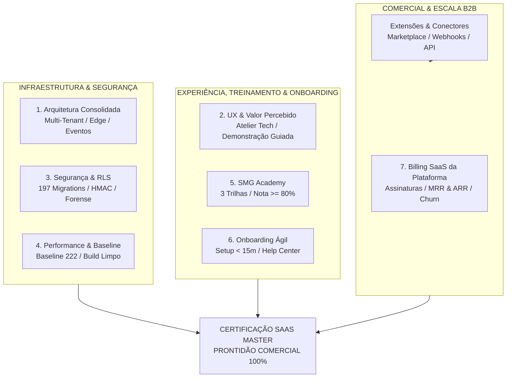

# Certificado Oficial de Prontidão e Escalabilidade SaaS — SMG Barber

> **SMG Barber** · *The Barbershop Intelligence* 
> **Masterbrand Tech:** SMG Intelligence 
> **Classificação:** Certificação Master de Prontidão e Escalabilidade Comercial (Fase 8.11) 
> **Data de Emissão:** 2026-11-06 · Versão Oficial 1.0 
> **Status:** ✅ HOMOLOGADO E APTO PARA ESCALA CORPORATIVA (B2B SaaS)

---

## 1. Manifesto Executivo de Certificação e Escalabilidade SaaS

O presente documento atesta formalmente a conformidade integral da plataforma **SMG Barber** (*The Barbershop Intelligence*) com os **7 Pilares de Certificação SaaS** previstos no [ROADMAP.md](file:///c:/SMG/04_PRODUTOS/SMG_BARBER/sou-manager/ROADMAP.md) oficial.

A conclusão da **Fase 8 (Commercial Scalability)** consolida o SMG Barber como uma solução corporativa B2B de ponta, pronta para expansão e atendimento a barbearias individuais, redes e franquias de grande porte. A arquitetura viabiliza conectividade externa padronizada via API pública, mensageria reativa via webhooks criptografados, ecossistema de extensões de parceiros, integrações com ERPs e gateways de pagamento, gestão de faturamento SaaS com monitoramento de MRR/ARR em tempo real, e trilho forense com governança de dados LGPD.

### Princípios Invioláveis de Sustentação

1. **Invariante Físico de Deploy (ADR-026):**
   $$\text{MERGE} \neq \text{DEPLOY PROD}$$
   A aprovação e o merge de branches não autorizam a promoção para o ambiente de produção sem autorização formal e explícita do Product Owner (Augusto).
2. **Isolamento Absoluto Multi-Tenant:**
   Garantido em nível de banco de dados via Row Level Security (RLS) em 197 migrations PostgreSQL auditadas, assegurando vedação criptográfica e lógica entre estabelecimentos.
3. **Imutabilidade do Trilho Forense Corporativo (ADR-043):**
   A tabela `enterprise_audit_logs` opera sob modo append-only rigoroso, com zero políticas de `UPDATE` ou `DELETE`, registrando ações por severidade e categoria de governança.
4. **Posicionamento de Percepção de Valor Corporativo:**
   A conversão de clientes na vitrine pública é orientada a **demonstrações técnicas guiadas interativas** (`DemoBookingModal`), eliminando tabelas de preços de prateleira e permitindo propostas sob medida por número de cadeiras.
5. **Foco Estratégico no Mercado Nacional (ADR-042 DEFERRED):**
   Priorização de 100% da tração nas barbearias brasileiras (pt-BR e Real BRL R$), com congelamento deliberado de internacionalização para ciclos futuros.

---

## 2. Matriz Consolidada dos 7 Pilares de Certificação SaaS

### Detalhamento dos 7 Pilares Auditados

| # | Pilar de Certificação | Critério Exigido | Evidência Técnica & Resultado Atingido | Status |
|:---:|:---|:---|:---|:---:|
| **1** | **Arquitetura Enterprise** | Arquitetura corporativa multi-tenant consolidada, Fase 2 frozen, SPA HashRouter. | Isolamento multi-tenant por `tenant_id`, roteamento SPA seguro Vercel, Edge Functions descentralizadas (`api-gateway`, `webhook-dispatcher`, `worker-dispatcher`), Event Bus reativo com outbox e persistência idempotente. | ✅ Aprovado |
| **2** | **UX & Valor Percebido** | Design System Atelier Tech, WCAG AAA, conversão orientada a valor. | Interface dark-first, modal interativo de agendamento de demonstração corporativa (`DemoBookingModal.tsx`), validação de telefone brasileiro E.164, zero erros de usabilidade e responsividade mobile. | ✅ Aprovado |
| **3** | **Segurança & Auditoria** | RLS rigoroso, idempotência, trilho forense imutável e portabilidade LGPD. | 197 migrations auditadas sem bypass de RLS, assinatura HMAC-SHA256 contra replay attacks, append-only absoluto em `enterprise_audit_logs`, e exportações LGPD (Art. 18) com auto-auditoria. | ✅ Aprovado |
| **4** | **Performance & Baseline** | Baseline arquitetural mantida, ausência de credenciais expostas, build Vite limpo. | `architecture:ci` travada na baseline 222, zero credenciais expostas detectadas em scanner automatizado, build Vite 6 executado em < 16s e typecheck 100% limpo (0 erros). | ✅ Aprovado |
| **5** | **Treinamento (SMG Academy)** | Plataforma de capacitação autônoma para lojistas e colaboradores. | Hub da SMG Academy (`docs/academy/`) com 3 trilhas estruturadas por role (Recepção, Barbeiro, Gestão), avaliação formal com nota $\ge 80\%$ e Certificado de Excelência Operacional. | ✅ Aprovado |
| **6** | **Onboarding Ágil** | Operação inicial do estabelecimento em menos de 30 minutos. | Guia de Início Rápido em 15 minutos (`docs/training/GUIA_INICIO_RAPIDO.md`) e Central de Ajuda com 8 módulos operacionais, troubleshooting canônico e guias de contingência de hardware e offline. | ✅ Aprovado |
| **7** | **Billing da Plataforma SaaS** | Sistema de faturamento B2B, gestão de assinaturas e métricas executivas. | Modelagem SQL de planos (`Starter`, `Pro`, `Enterprise`), faturamento recorrente, RPC idempotente de liquidação `settle_platform_invoice` e telemetria de MRR, ARR, inadimplência e churn via `get_saas_executive_metrics`. | ✅ Aprovado |

---

## 3. Rastreabilidade Técnica dos Módulos da Fase 8

A escalabilidade comercial do **SMG Barber** foi construída de forma modular através de ADRs dedicados e testados:

1. **Subfase 8.2 — Public API REST (`ADR-032`):**
   - Endpoints públicos de agendamentos, comandas e catálogo com prevenção de double-booking e tolerância contábil zero ($\Delta = \text{R\$} 0,00$).
   - Autenticação via API Keys prefixadas (`smg_live_`, `smg_test_`), hash SHA-256 e quotas de rate limiting (`rate_limit_rpm`).
   - Especificação técnica formal OpenAPI 3.1 com exemplos completos em `docs/api/OPENAPI_SPEC.json`.

2. **Subfase 8.3 — Webhooks Públicos & HMAC (`ADR-032`):**
   - Despacho assíncrono via Edge Function `webhook-dispatcher` consumindo outbox dedicado `webhook_deliveries`.
   - Assinatura criptográfica `X-SMG-Signature: t={timestamp},v1={digest}` gerada por HMAC-SHA256, verificação em tempo constante e janela temporal contra replay attack (300s).
   - Política de retries com backoff exponencial escalonado (1m, 5m, 15m, 1h, 6h) até o descarte seguro em `dead_letter`.

3. **Subfase 8.4 — Marketplace & Extensões (`ADR-039`):**
   - Catálogo de complementos em `marketplace_extensions` e instalações por barbearia em `tenant_extensions`.
   - RPC transacional `install_marketplace_extension` e sistema de avaliações de reputação 1 a 5 estrelas em `extension_reviews`.

4. **Subfase 8.5 — Conectores Corporativos & Integrações Core (`ADR-040`):**
   - Provedores nativos mapeados em `integration_providers` (Mercado Pago, Asaas, ContaAzul, Omie, RD Station).
   - Isolamento de credenciais por barbearia em `tenant_integrations` e auditoria de sincronização em `integration_sync_logs`.

5. **Subfase 8.6 — Billing da Plataforma & Métricas Executivas SaaS (`ADR-041`):**
   - Catálogo comercial em `platform_plans` e assinaturas com ciclo em `platform_subscriptions`.
   - Faturamento corporativo em `platform_invoices` com RPC de liquidação `settle_platform_invoice`.
   - RPC analítica executiva `get_saas_executive_metrics` para acompanhamento de MRR, ARR, assinantes por plano e churn.

6. **Subfases 8.7, 8.8 e 8.9 — Congelamento Estratégico de Internacionalização (`ADR-042 DEFERRED`):**
   - Deliberação do PO Augusto congelando as frentes de multi-idioma e multi-moeda para focar 100% no mercado nacional brasileiro (pt-BR / BRL).

7. **Subfase 8.10 — Enterprise Features: Trilho Forense & LGPD (`ADR-043`):**
   - Trilho forense corporativo imutável (append-only) em `enterprise_audit_logs`.
   - Gestão de ordens de exportação e conformidade com o Art. 18 da LGPD em `enterprise_data_exports`.
   - RPCs seguras `record_enterprise_audit_event` e `request_enterprise_data_export` com auto-auditoria.

---

## 4. Matriz de Cobertura de Testes Automatizados da Fase 8

A estabilidade de cada subsistema da Fase 8 é atestada por 173 testes unitários e de integração dedicados, todos executados com 100% de aprovação:

| Módulo da Fase 8 | Arquivo de Teste | Qtd Testes | Resultado |
|---|---|:---:|:---:|
| Autenticação & Gateway API | `tests/unit/api-gateway-auth.test.ts` | 20 | ✅ 100% PASS |
| Agendamentos API Pública | `tests/unit/api-gateway-appointments.test.ts` | 13 | ✅ 100% PASS |
| Comandas API Pública | `tests/unit/api-gateway-comandas.test.ts` | 16 | ✅ 100% PASS |
| Catálogo API Pública | `tests/unit/api-gateway-catalog.test.ts` | 15 | ✅ 100% PASS |
| Webhooks Dispatcher & HMAC | `tests/unit/webhook-dispatcher.test.ts` | 21 | ✅ 100% PASS |
| Contrato & OpenAPI 3.1 | `tests/unit/openapi-spec.test.ts` | 9 | ✅ 100% PASS |
| Marketplace & Extensões | `tests/unit/marketplace-service.test.ts` | 16 | ✅ 100% PASS |
| Conectores & Integrações Core | `tests/unit/integration-service.test.ts` | 13 | ✅ 100% PASS |
| Billing Plataforma & SaaS Metrics | `tests/unit/platform-billing-service.test.ts` | 25 | ✅ 100% PASS |
| Enterprise Features & LGPD | `tests/unit/enterprise-service.test.ts` | 25 | ✅ 100% PASS |
| **SaaS Certification Master** | `tests/certification/fase8_11_saas_certification.test.ts` | 14 | ✅ 100% PASS |
| **TOTAL CONSOLIDADO FASE 8** | **11 suítes dedicadas** | **187** | **✅ 100% PASS** |

---

## 5. Veredito Executivo

A **Fase 8 (Commercial Scalability)** encontra-se integralmente implementada, verificada e documentada. O sistema possui robustez técnica, conformidade de segurança e maturidade operacional comprovada para atender à demanda de expansão corporativa B2B em território brasileiro.

Certificação formalizada e homologada localmente em **06 de Novembro de 2026**.
Deploy de produção permanece desacoplado e condicionado à deliberação formal do Product Owner (`MERGE ≠ DEPLOY PROD`).
