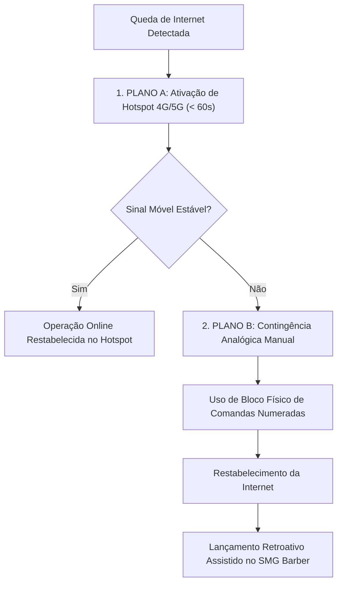

# Guia de Contingência de Hardware, Conexão & Periféricos — SMG Barber

> **SMG Barber** · *The Barbershop Intelligence* 
> **Masterbrand Tech:** SMG Intelligence 
> **Classificação:** Manual de Operação e Resiliência Física 
> **Última Atualização:** 2026-11-04 · Versão 1.0

---

## 1. Plano de Contingência para Queda de Internet

Uma barbearia de alta performance não pode interromper a recepção ou deixar clientes aguardando na bancada por instabilidades no provedor de internet. O SMG Barber opera sob protocolo de dupla resiliência:

### 1.1 Plano A: Hotspot 4G/5G de Alta Velocidade (Tempo de Resposta: < 60 segundos)
1. No celular da recepção ou do gerente, acesse as **Configurações $\rightarrow$ Ponto de Acesso Pessoal / Roteador Wi-Fi**.
2. Ative o compartilhamento de dados móveis com senha segura conhecida pela equipe.
3. No computador do caixa, clique no ícone de Wi-Fi e conecte-se à rede do celular.
4. O SMG Barber consome menos de 50 KB por requisição, operando com total fluidez mesmo em conexões móveis convencionais.
5. Ao retornar a fibra ótica principal, reconecte o computador à rede original da loja.

### 1.2 Plano B: Contingência Analógica Extrema (Tempo de Resposta: Imediato)
Caso haja um blecaute total de telecomunicações (queda simultânea de fibra e rede celular):
1. **Bloco de Comandas de Emergência:** A recepção deve manter na gaveta um bloco impresso de comandas de papel numeradas.
2. **Anotação Obrigatória:** Registre na folha de papel:
   - Nome do Cliente e Telefone de contato;
   - Barbeiro responsável pelo atendimento;
   - Serviços executados e produtos consumidos;
   - Forma de pagamento e valor exato cobrado;
   - Caso cartão, anexe a filipeta impressa pela maquininha física na comanda.
3. **Liberação do Cliente:** O cliente é atendido e liberado cordialmente sem nenhum atrito.
4. **Lançamento Retroativo:** Assim que a conexão for restabelecida:
   - Abra o SMG Barber e acesse a Agenda na data correspondente;
   - Lance cada atendimento com seus respectivos barbeiros, serviços e comprovantes;
   - Feche a comanda vinculando a forma de pagamento real anotada;
   - Essa rotina preserva o caixa cego, a comissão exata de cada barbeiro e o estoque.

---

## 2. Impressoras Térmicas e Comprovantes

O SMG Barber suporta impressão padrão de cupom não-fiscal para bobinas térmicas de **80mm (padrão de balcão)** e **58mm (mini-impressoras portáteis)**.

### 2.1 Falhas Comuns e Soluções Imediatas

| Sintoma | Causa Técnica | Ação Corretiva |
|---|---|---|
| **A impressora cospe o papel em branco sem texto** | Bobina térmica colocada do lado invertido | Abra a tampa da impressora. Inverta o lado do rolo de forma que a face sensível ao calor fique voltada para a cabeça térmica de impressão. |
| **A luz vermelha (Error) fica piscando** | Fim da bobina ou tampa mal travada | Substitua o rolo por um novo e pressione a tampa até ouvir o clique duplo de travamento. |
| **O comprovante não sai após clicar em Imprimir** | Fila de impressão do Windows travada (Spooler) | Abra o menu Iniciar do Windows, digite `cmd`, execute como Administrador e rode: `net stop spooler && net start spooler`. |
| **Corte automático do papel (guilhotina) emperrou** | Pedaço de papel preso na lâmina ou engrenagem fora de posição | Desligue a impressora da tomada. Abra a tampa frontal com cuidado e gire a engrenagem manual da guilhotina até que a lâmina recue totalmente. |

### 2.2 Teste de Impressão Direto na Impressora (Self-Test / Feed Test)
Para certificar se o problema é na impressora física ou no computador:
1. Desligue a impressora no interruptor.
2. Segure pressionado o botão **FEED** (Avançar Papel).
3. Sem soltar o botão FEED, ligue o interruptor da impressora.
4. Mantenha o botão pressionado por 2 segundos e solte.
5. A impressora imprimirá um relatório de autoteste com velocidade, fontes e densidade:
   - Se o papel sair impresso: a impressora está 100% saudável; o problema está no cabo USB ou no driver do computador.
   - Se nada for impresso: verifique a fonte de alimentação elétrica e o cabeçote térmico.

---

## 3. Maquininhas de Cartão (POS e SmartPOS)

O SMG Barber é compatível com todas as operadoras do mercado brasileiro (Stone, PagBank, Cielo, Rede, SafraPay, Mercado Pago, etc.), operando de forma desacoplada para garantir que a barbearia nunca fique refém de uma adquirente exclusiva.

### 3.1 Procedimentos de Segurança e Boas Práticas
- **Conferência de Comprovante:** A via do estabelecimento emitida pela maquininha contém o **NSU**, a **Bandeira** e a **Data/Hora**. Esse comprovante é a garantia legal da transação e deve ser guardado na gaveta para a conferência noturna de caixa.
- **Bateria e Carregamento:** Nunca deixe a maquininha principal com menos de 20% de bateria durante os horários de pico (sextas e sábados a partir das 16h). Mantenha uma base de carregamento dedicada no balcão da recepção.
- **Alternância de Conexão na Maquininha:** Se a maquininha apresentar a mensagem *"Erro de Conexão"* ou *"Tentando Conectar"*, acesse o menu de rede da própria máquina e alterne entre **Wi-Fi da Loja** e **Chip de Celular (SIM 1/2)**.

---

## 4. Tablets e Smartphones de Bancada

Para barbearias que utilizam tablets ou smartphones fixados nos espelhos de atendimento para os barbeiros:

1. **Bloqueio de Rotação de Tela:** Configure o dispositivo para manter o layout fixado na orientação mais confortável (retrato para celulares, paisagem para tablets).
2. **Tempo de Bloqueio de Tela:** Ajuste o bloqueio automático de tela do Android/iOS para pelo menos 10 a 15 minutos de inatividade, evitando que o barbeiro precise desbloquear o aparelho a cada corte.
3. **Atalho na Tela Inicial (PWA / WebApp):**
   - No navegador Chrome/Safari do celular, acesse o endereço da sua barbearia;
   - Toque no menu de opções (três pontos ou compartilhar) e selecione **Adicionar à Tela Inicial**;
   - O SMG Barber funcionará em modo tela cheia, sem barra de endereços, como um aplicativo nativo.

---

## 5. Requisitos Mínimos de Infraestrutura Recomendados

Para operação sem interrupções, a **SMG Intelligence** recomenda a seguinte infraestrutura física para cada unidade:

- **Conexão Primária:** Banda larga fixa (Fibra Ótica) com no mínimo 50 Mbps de velocidade de download e 20 Mbps de upload;
- **Conexão de Contingência:** Smartphone da recepção com plano 4G/5G com capacidade de roteamento Wi-Fi;
- **Proteção Elétrica:** Nobreak senoidal básico de 600VA conectado ao computador da recepção e ao modem/roteador Wi-Fi (garante 30 a 45 minutos de autonomia em caso de queda de luz);
- **Computador da Recepção:** Qualquer computador ou notebook com navegador atualizado (Google Chrome, Microsoft Edge ou Safari), mínimo 4 GB de memória RAM e sistema operacional atualizado.
