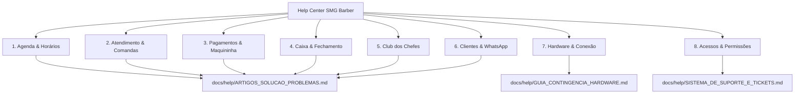
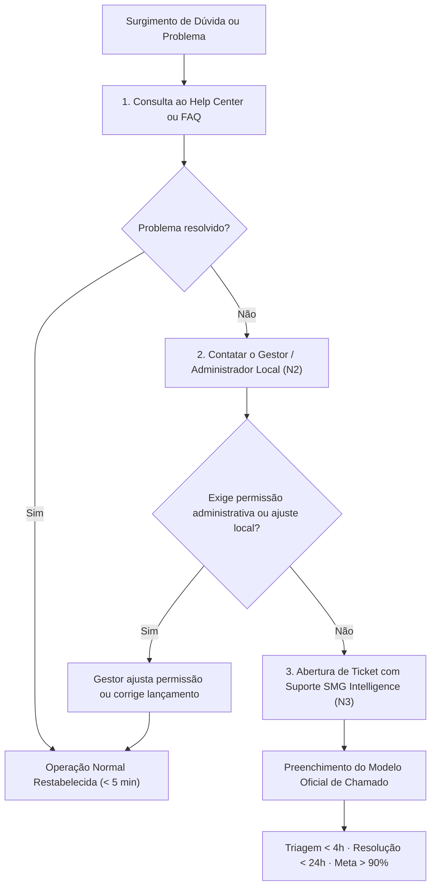

# Central de Ajuda & Base de Conhecimento — SMG Barber

> **SMG Barber** · *The Barbershop Intelligence* 
> **Masterbrand Tech:** SMG Intelligence 
> **Classificação:** Documentação Oficial de Suporte & Autoatendimento Operacional 
> **Última Atualização:** 2026-11-04 · Versão 1.0

---

## 1. Visão Geral & Manifesto de Autoatendimento

A **Central de Ajuda (Help Center)** do **SMG Barber** foi projetada para garantir que nenhuma barbearia pare sua operação por dúvidas conceituais, incidentes cotidianos de conexão ou falhas de periféricos.

Nosso compromisso operacional baseia-se em três pilares fundamentais:
1. **Autonomia Imediata (Resolução < 5 minutos):** 90% das contingências operacionais possuem solução documentada e autoexecutável pela própria recepção ou barbeiro sem necessidade de intervenção humana externa.
2. **Padrão Canônico de Troubleshooting:** Todo artigo de resolução segue a metodologia técnica estruturada:
   $$\text{Sintoma Observado} \longrightarrow \text{Causa Raiz Provável} \longrightarrow \text{Passo a Passo de Resolução} \longrightarrow \text{Como Prevenir}$$
3. **Escalonamento Estruturado (SLA < 24h):** Quando um incidente de plataforma exigir intervenção da engenharia, o fluxo de escalonamento N1/N2/N3 garante triagem rápida, telemetria completa e resolução com satisfação superior a 90%.

---

## 2. Mapa das 8 Categorias da Base de Conhecimento

A base de conhecimento cobre integralmente todos os fluxos de ponta a ponta do SMG Barber, organizada em 8 áreas operacionais:

| # | Categoria | Descrição do Escopo | Onde Consultar |
|---|---|---|---|
| **1** | **Agenda & Horários** | Agendamentos, conflitos de horários, bloqueios de cadeira e grade de profissionais | [`ARTIGOS_SOLUCAO_PROBLEMAS.md`](file:///c:/SMG/04_PRODUTOS/SMG_BARBER/sou-manager/docs/help/ARTIGOS_SOLUCAO_PROBLEMAS.md#1-agenda--horários) |
| **2** | **Atendimento & Comandas** | Comandas abertas, comanda presa em atendimento, adição de itens e cancelamento | [`ARTIGOS_SOLUCAO_PROBLEMAS.md`](file:///c:/SMG/04_PRODUTOS/SMG_BARBER/sou-manager/docs/help/ARTIGOS_SOLUCAO_PROBLEMAS.md#2-atendimento--comandas) |
| **3** | **Pagamentos & Checkout** | Divergência de maquininha, múltiplos meios de pagamento, gorjetas e divisão | [`ARTIGOS_SOLUCAO_PROBLEMAS.md`](file:///c:/SMG/04_PRODUTOS/SMG_BARBER/sou-manager/docs/help/ARTIGOS_SOLUCAO_PROBLEMAS.md#3-pagamentos--checkout) |
| **4** | **Caixa & Fechamento** | Caixa cego, quebra de caixa, suprimentos, sangrias e estorno pós-fechamento | [`ARTIGOS_SOLUCAO_PROBLEMAS.md`](file:///c:/SMG/04_PRODUTOS/SMG_BARBER/sou-manager/docs/help/ARTIGOS_SOLUCAO_PROBLEMAS.md#4-caixa--fechamento-diário) |
| **5** | **Club dos Chefes** | Assinaturas, saldo de créditos, resgates na comanda e cancelamento de planos | [`ARTIGOS_SOLUCAO_PROBLEMAS.md`](file:///c:/SMG/04_PRODUTOS/SMG_BARBER/sou-manager/docs/help/ARTIGOS_SOLUCAO_PROBLEMAS.md#5-club-dos-chefes-assinaturas) |
| **6** | **Clientes & WhatsApp** | Clientes duplicados, reengajamento de churn, histórico dividido e LGPD | [`ARTIGOS_SOLUCAO_PROBLEMAS.md`](file:///c:/SMG/04_PRODUTOS/SMG_BARBER/sou-manager/docs/help/ARTIGOS_SOLUCAO_PROBLEMAS.md#6-clientes--whatsapp) |
| **7** | **Hardware & Conexão** | Queda de internet, impressoras térmicas (80mm/58mm), tablets de bancada e POS | [`GUIA_CONTINGENCIA_HARDWARE.md`](file:///c:/SMG/04_PRODUTOS/SMG_BARBER/sou-manager/docs/help/GUIA_CONTINGENCIA_HARDWARE.md) |
| **8** | **Acessos & Permissões** | Perfis de acesso (Recepção, Barbeiro, Gestor), redefinição de senha e bloqueios | [`SISTEMA_DE_SUPORTE_E_TICKETS.md`](file:///c:/SMG/04_PRODUTOS/SMG_BARBER/sou-manager/docs/help/SISTEMA_DE_SUPORTE_E_TICKETS.md) |

---

## 3. Matriz de Busca Rápida por Sintoma Operacional

Encontre a solução imediata para a situação que você está enfrentando no momento:

| O que está acontecendo? | Causa Mais Provável | Ação Rápida Recomendada | Artigo Detalhado |
|---|---|---|---|
| **A maquininha imprimiu o comprovante, mas o sistema deu erro ao finalizar** | Oscilação passageira de conexão no momento do commit | **NÃO passe o cartão de novo.** Digite o NSU/Código do comprovante nas notas e conclua a comanda. | [Ver Artigo 3.1](file:///c:/SMG/04_PRODUTOS/SMG_BARBER/sou-manager/docs/help/ARTIGOS_SOLUCAO_PROBLEMAS.md#31-divergência-entre-maquininha-pos-e-status-da-comanda) |
| **Comanda bloqueada como "Em atendimento" e não consigo fechar no caixa** | Barbeiro ainda com a comanda aberta em edição no celular | Peça para o barbeiro salvar/liberar no app mobile ou use a liberação administrativa. | [Ver Artigo 2.1](file:///c:/SMG/04_PRODUTOS/SMG_BARBER/sou-manager/docs/help/ARTIGOS_SOLUCAO_PROBLEMAS.md#21-comanda-bloqueada-em-atendimento-na-bancada) |
| **A internet caiu e tenho 3 clientes na fila do caixa para pagar** | Queda da operadora de banda larga | Ative o Hotspot 4G/5G do celular em até 60 segundos ou use o Protocolo Analógico Contingencial. | [Ver Guia Hardware](file:///c:/SMG/04_PRODUTOS/SMG_BARBER/sou-manager/docs/help/GUIA_CONTINGENCIA_HARDWARE.md#1-plano-de-contingência-para-queda-de-internet) |
| **Cliente cadastrado duas vezes com telefones ou nomes parecidos** | Criação manual na recepção sem busca prévia por telefone | Execute a unificação assistida ou arquivamento do cadastro duplicado. | [Ver Artigo 6.1](file:///c:/SMG/04_PRODUTOS/SMG_BARBER/sou-manager/docs/help/ARTIGOS_SOLUCAO_PROBLEMAS.md#61-clientes-duplicados-com-histórico-dividido) |
| **Comanda fechada com meio de pagamento errado (Ex: Dinheiro em vez de PIX)** | Equívoco do operador na seleção do botão de checkout | Utilize o estorno administrativo do caixa do dia antes da conferência cega. | [Ver Artigo 4.1](file:///c:/SMG/04_PRODUTOS/SMG_BARBER/sou-manager/docs/help/ARTIGOS_SOLUCAO_PROBLEMAS.md#41-comanda-fechada-com-meio-de-pagamento-incorreto) |
| **Impressora térmica de cupom não está imprimindo o comprovante** | Driver travado, fila de impressão presa ou sem papel | Verifique papel térmico, execute teste feed manual e reinicie o spooler do Windows. | [Ver Guia Hardware](file:///c:/SMG/04_PRODUTOS/SMG_BARBER/sou-manager/docs/help/GUIA_CONTINGENCIA_HARDWARE.md#2-impressoras-térmicas-e-comprovantes) |
| **Créditos do Club dos Chefes não aparecem para abater o corte** | Assinatura com cobrança pendente ou cliente cadastrado sob outro CPF | Consulte a tela de assinaturas do Club para confirmar o status do plano e telefone vinculado. | [Ver Artigo 5.1](file:///c:/SMG/04_PRODUTOS/SMG_BARBER/sou-manager/docs/help/ARTIGOS_SOLUCAO_PROBLEMAS.md#51-crédito-do-club-dos-chefes-não-disponível-no-checkout) |
| **Barbeiro não consegue visualizar a sua agenda ou relatórios de comissão** | Papel de acesso atribuído incorretamente no cadastro da equipe | Administrador deve ajustar o perfil para `barber` com tenant ativo em Gestão de Pessoal. | [Ver Artigo 8.1](file:///c:/SMG/04_PRODUTOS/SMG_BARBER/sou-manager/docs/help/ARTIGOS_SOLUCAO_PROBLEMAS.md#81-barbeiro-sem-acesso-à-sua-própria-agenda-ou-comissões) |

---

## 4. Árvore de Decisão para Autoatendimento

Antes de abrir um chamado, siga o fluxo de triagem autônoma:

---

## 5. Acordo de Nível de Serviço (SLA) & Indicadores

O suporte da **SMG Intelligence** compromete-se com as seguintes métricas operacionais para o **SMG Barber**:

| Nível de Severidade | Definição | Tempo de Primeira Resposta | Tempo Alvo de Resolução | Canal Preferencial |
|---|---|---|---|---|
| **Crítico (P1)** | Parada total de operação da barbearia (impossibilidade de emitir comandas ou registrar pagamentos) | **< 1 hora** | **< 4 horas** | Chamado com Tag `URGENTE` + WhatsApp de Suporte |
| **Alto (P2)** | Funcionalidade com degradação (ex: agendamento online lento, falha em módulo específico com contorno viável) | **< 2 horas** | **< 12 horas** | Portal de Chamados / E-mail de Suporte |
| **Normal (P3)** | Dúvidas de configuração, ajustes cadastrais ou solicitações operacionais cotidianas | **< 4 horas** | **< 24 horas** | Portal de Chamados / Central de Ajuda |
| **Sugestão (P4)** | Feedback de usabilidade, novas ideias e melhorias de fluxo | **< 24 horas** | Próximos ciclos de release | Formulário de Feedback |

> [!IMPORTANT]
> **Meta de Resolução Global:** Superior a **85% das solicitações N3 resolvidas em menos de 24 horas úteis**, mantendo índice de satisfação do cliente (**CSAT**) consolidado acima de **90%**.

---

## 6. Recursos Complementares

- 🎓 **Capacitação Profissional:** [SMG Academy](file:///c:/SMG/04_PRODUTOS/SMG_BARBER/sou-manager/docs/academy/README.md)
- 📖 **Manual de Operação:** [Manual do Usuário SMG Barber](file:///c:/SMG/04_PRODUTOS/SMG_BARBER/sou-manager/docs/training/MANUAL_DO_USUARIO_SMG_BARBER.md)
- ❓ **Perguntas Rápidas:** [FAQ Operacional](file:///c:/SMG/04_PRODUTOS/SMG_BARBER/sou-manager/docs/training/FAQ_OPERACIONAL.md)
- ⚡ **Atalhos de Teclado:** [Guia de Atalhos](file:///c:/SMG/04_PRODUTOS/SMG_BARBER/sou-manager/docs/training/ATALHOS_E_PRODUTIVIDADE.md)
