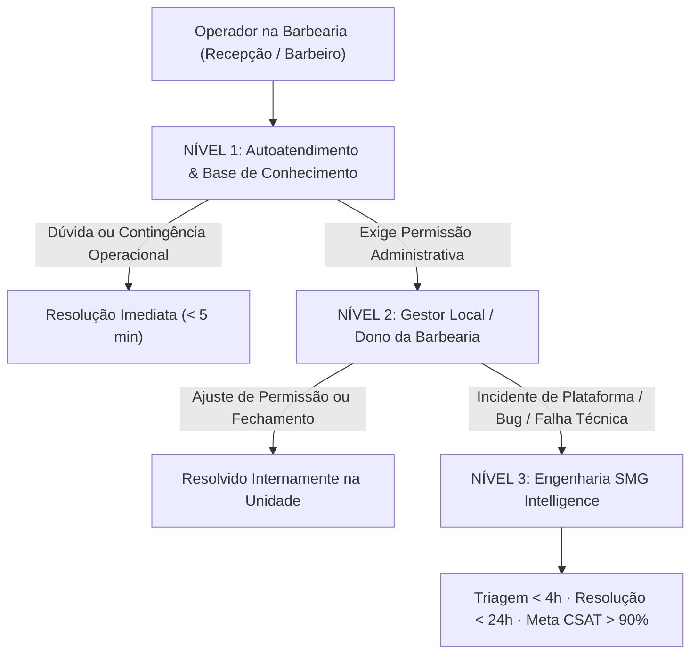

# Sistema de Suporte, SLA & Abertura de Chamados — SMG Barber

> **SMG Barber** · *The Barbershop Intelligence*<br />
> **Masterbrand Tech:** SMG Intelligence<br />
> **Classificação:** Diretriz Operacional de Suporte Técnico & Gestão de Incidentes<br />
> **Última Atualização:** 2026-11-04 · Versão 1.0

---

## 1. Protocolo de Suporte Escalonado (N1 / N2 / N3)

O ecossistema de suporte do **SMG Barber** opera sob um modelo de escalonamento em 3 camadas, projetado para resolver a esmagadora maioria das dúvidas na ponta e direcionar apenas anomalias reais de sistema para a engenharia da **SMG Intelligence**.



### 1.1 Detalhamento dos Níveis de Suporte

| Nível | Responsável | Escopo de Atuação | Tempo Alvo |
|---|---|---|---|
| **N1** | Operador Local / Recepção | Consulta aos artigos da Central de Ajuda (`docs/help/`), manuais de treinamento e FAQs. Resolução de dúvidas de uso, atalhos de teclado e contingência de conexão. | **< 5 minutos** |
| **N2** | Gerente / Dono da Unidade | Permissões de colaboradores, aprovação de cadastros de barbeiros, ajustes de meios de pagamento em comandas abertas, sangrias/suprimentos e conferência de caixa. | **< 15 minutos** |
| **N3** | Engenharia SMG Intelligence | Falhas de sistema (bugs), indisponibilidade de serviços, problemas de persistência no banco de dados, falhas de sincronização e suporte técnico avançado. | **Resposta < 4h / Resolução < 24h** |

---

## 2. Acordo de Nível de Serviço (SLA) & Metas Operacionais

A **SMG Intelligence** firma compromisso público com todas as unidades franqueadas ou clientes do **SMG Barber** nos seguintes parâmetros:

### 2.1 Tabela de Severidade e Tempos de Resposta

| Severidade | Descrição do Impacto | Tempo Máximo de Primeira Resposta | Tempo Alvo de Resolução | Canal de Acionamento |
|---|---|---|---|---|
| **P1 — Crítico** | Paralisação completa de operações essenciais (impossível abrir comandas, emitir pagamentos ou fechar caixa em toda a unidade). | **Até 1 hora** | **Até 4 horas** | Linha de Emergência / WhatsApp de Plantão |
| **P2 — Alto** | Degradação séria de fluxo com trabalho contingencial possível (ex: agendamento online lento, falha em relatório gerencial específico). | **Até 2 horas** | **Até 12 horas** | Portal de Chamados / E-mail de Suporte |
| **P3 — Normal** | Dúvidas pontuais, solicitações de recadastro ou ajustes operacionais não impeditivos. | **Até 4 horas** | **Até 24 horas** | Central de Ajuda / Ticket Padrão |
| **P4 — Melhoria** | Sugestões de produto, melhorias de interface ou ideias de novas funcionalidades. | **Até 24 horas** | Backlog contínuo | Formulário de Ideias |

### 2.2 Indicadores Chave de Desempenho (KPIs de Suporte)
- **Taxa de Resolução em Menos de 24h:** Meta contratual $\ge$ **85%** de todos os tickets N3 encerrados satisfatoriamente em até 24 horas úteis.
- **Índice de Satisfação do Atendimento (CSAT):** Meta $\ge$ **90%** de avaliações positivas (*Satisfeito* ou *Muito Satisfeito*).
- **Taxa de Reabertura de Chamados:** Meta $\le$ **5%**, garantindo resolução definitiva na primeira intervenção.

---

## 3. Checklist Obrigatório de Pré-Abertura de Chamado

Para que a equipe de engenharia consiga isolar e corrigir a anomalia sem trocas desnecessárias de mensagens, o operador ou gerente deve verificar 5 itens antes de enviar o ticket:

1. **Identificação da Unidade:** Nome da barbearia e subdomínio/URL exata (ex: `https://sanchez.soumanager.com` ou ambiente local).
2. **Usuário Envolvido:** E-mail de login e papel (`admin`, `manager`, `receptionist` ou `barber`).
3. **Módulo Afetado:** Em qual tela o problema ocorreu (ex: Agenda, Comandas, Caixa, Fechamento, Clientes).
4. **Reproducibilidade:** O problema aconteceu uma única vez ou se repete toda vez que clica no botão?
5. **Evidência Visual:** Print de tela (captura) ou foto legível do erro com o console do navegador ou texto da mensagem.

---

## 4. Modelo Oficial de Ticket / Chamado de Suporte

Ao abrir uma solicitação para o Suporte N3 da **SMG Intelligence**, utilize rigorosamente o modelo estruturado abaixo:

```markdown
### [CHAMADO DE SUPORTE SMG BARBER]

- **Unidade / Barbearia:** [Nome da Barbearia]
- **Subdomínio / Tenant ID:** [ex: sanchez-barber / uuid do tenant]
- **Responsável pelo Chamado:** [Nome Completo]
- **Telefone / WhatsApp de Contato:** [(DDD) 9XXXX-XXXX]
- **Data e Hora da Ocorrência:** [YYYY-MM-DD HH:MM]
- **Nível de Severidade Estimado:** [P1 - Crítico | P2 - Alto | P3 - Normal | P4 - Melhoria]

---

#### 1. Descrição Sintética do Problema
[Explique de forma clara e direta o que está acontecendo]

#### 2. Passos para Reproduzir o Erro
1. Acessei a tela [Nome da Tela]
2. Cliquei no botão [Nome do Botão]
3. Preenchi os campos [Campos preenchidos]
4. O sistema exibiu a mensagem de erro: "[Texto exato da mensagem]"

#### 3. Comportamento Esperado
[Explique o que deveria ter acontecido na operação normal]

#### 4. Contingência Adotada
[Descreva se foi utilizado o Hotspot móvel, comanda física analógica ou outro procedimento temporário]

#### 5. Evidências Anexas
- [ ] Foto/Print da tela de erro anexado
- [ ] Comprovante da maquininha anexado (se envolver pagamentos)
- [ ] Log ou mensagem do navegador anexado
```

---

## 5. Canais Oficiais de Atendimento da Masterbrand

A Masterbrand **SMG Intelligence** centraliza os canais de atendimento oficial para manter registro auditável e histórico de chamados:

- 💻 **Central de Tickets Online:** Portal de Suporte Integrado ao SMG Barber
- 📧 **E-mail de Suporte Técnico:** `suporte@soumanager.com`
- 💬 **WhatsApp de Plantão Crítico (P1):** Linha direta dedicada para gerentes cadastrados
- 📚 **Repositório de Conhecimento:** [docs/help/README.md](file:///c:/SMG/04_PRODUTOS/SMG_BARBER/sou-manager/docs/help/README.md)
